# Mini-Web-Projects

Small web projects by Mohammad Diab, each in its own folder, built with plain HTML, CSS and vanilla JavaScript. No libraries, no build step, and every project runs on GitHub Pages.

**View them:** https://mohammad-diab.github.io/Mini-Web-Projects/

## Projects

| Project | Year | Description | Live |
|---|---|---|---|
| [Toggle Button](Toggle-Button) | 2018 | A toggle switch made with CSS and JavaScript: click it and the knob slides across while the background fades between light grey and green. | [Open](https://mohammad-diab.github.io/Mini-Web-Projects/Toggle-Button/) |
| [CSS Tooltip](CSS-Tooltip) | 2018 | A tooltip made with CSS only, fading in above the text on hover. | [Open](https://mohammad-diab.github.io/Mini-Web-Projects/CSS-Tooltip/) |
| [My Logo](My-Logo) | 2018 | An animated logo page: the picture grows inside spinning rings above "Hi, I'm Mohammad." | [Open](https://mohammad-diab.github.io/Mini-Web-Projects/My-Logo/) |
| [Four Plus](Four-Plus) | 2018 | The web version of the Four Plus number-guessing game in a console-style window, with the original C# console code. | [Open](https://mohammad-diab.github.io/Mini-Web-Projects/Four-Plus/) |
| [Calculator](Calculator) | 2018 | A simple calculator with digits, brackets and the four basic operations. | [Open](https://mohammad-diab.github.io/Mini-Web-Projects/Calculator/) |
| [Dynamic Table](Dynamic-Table) | 2018 | A table whose rows and cells are built by JavaScript. | [Open](https://mohammad-diab.github.io/Mini-Web-Projects/Dynamic-Table/) |
| [Login](Login) | 2018 | A login form whose icons come from one CSS sprite image. | [Open](https://mohammad-diab.github.io/Mini-Web-Projects/Login/) |
| [SVG Progress Ring](SVG-Progress-Ring) | 2019 | A small JavaScript library that draws an SVG progress ring with a start angle, percentage, colour and direction. | [Open](https://mohammad-diab.github.io/Mini-Web-Projects/SVG-Progress-Ring/) |
| [Fluent Design](Fluent-Design) | 2019 | Six UI controls styled after Microsoft's Fluent Design: Button, Checkbox, Link Button, ProgressBar, Radio Button and Toggle Button. | [Open](https://mohammad-diab.github.io/Mini-Web-Projects/Fluent-Design/) |
| [TimeLine](TimeLine) | 2019–2021 | A timeline of projects and technologies over years and months, drawn by a small JavaScript class from data.json, a page at a time. | [Open](https://mohammad-diab.github.io/Mini-Web-Projects/TimeLine/) |
| [Sprite Icons](Sprite-Icons) | 2020 | Three SVG icons drawn as a sprite of symbols, with live stroke and fill colours. | [Open](https://mohammad-diab.github.io/Mini-Web-Projects/Sprite-Icons/) |

## Toggle Button

A toggle switch: click it and the red knob slides from one side to the other while the background fades from light grey to green, and back on the next click. The motion and the colour fade are both driven by a small JavaScript timer; the page is `html.htm`.

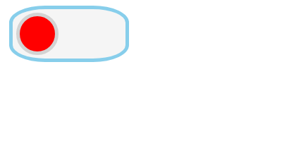

## CSS Tooltip

A tooltip made with CSS only: hover the text and a purple box fades in above it with a short slide.

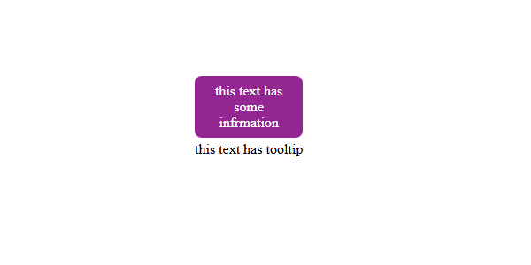

## My Logo

An animated logo page: the picture grows inside a frame of rotating quarter rings, then settles above "Hi, I'm Mohammad." The animation runs for 20 seconds. The history keeps the first draft and the reworked final version.

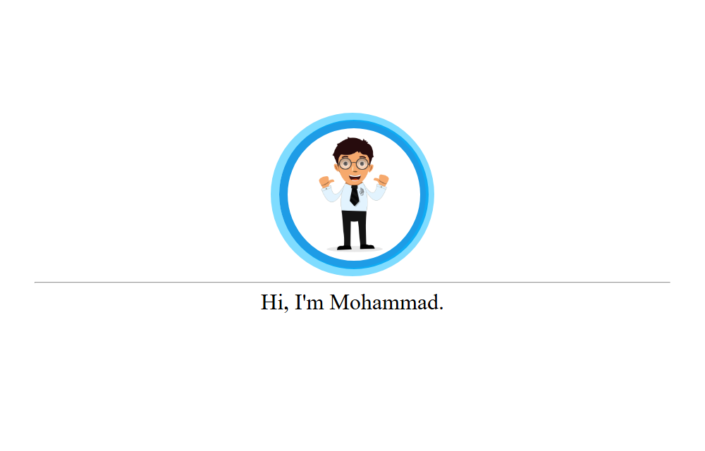

## Four Plus

The web version (1.2) of the Four Plus game: think of a 4-digit number with unique digits while the computer keeps one of its own, then take turns guessing and scoring each other's guesses with `+` (right digit, right position) and `>` (right digit, wrong position). It runs in a console-style window; type `new` to start. `orginal.cs` is the C# console version it was ported from.

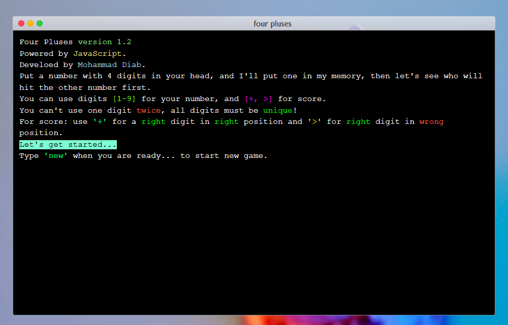

## Calculator

A simple calculator: digits, brackets, the four basic operations, clear and equals.

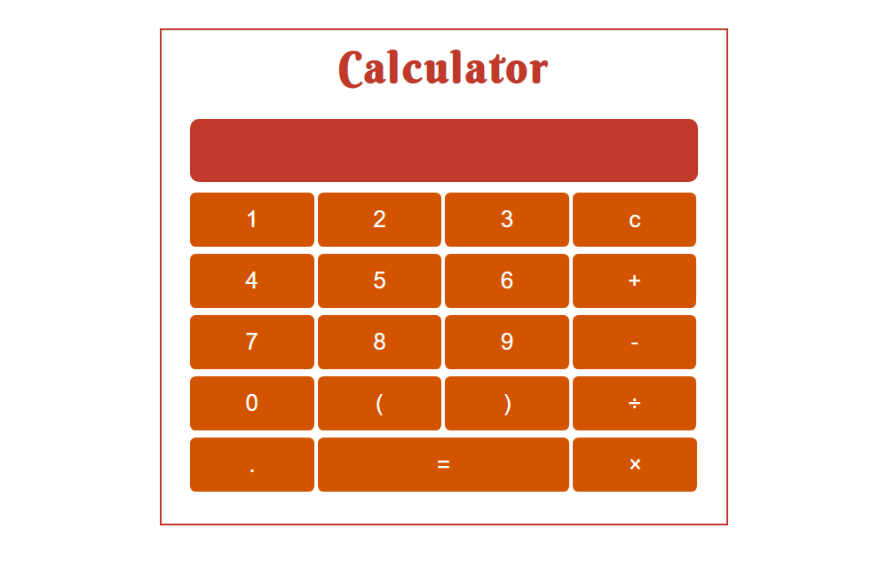

## Dynamic Table

A small exercise: JavaScript builds the table rows and cells from a column count and a cell count.

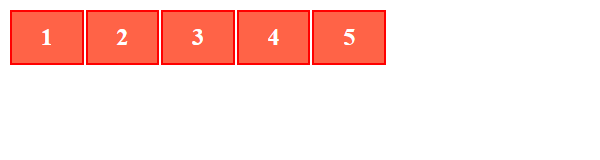

## Login

A static login form; the user and lock icons in the fields come from one CSS sprite image (`sprite.png`).

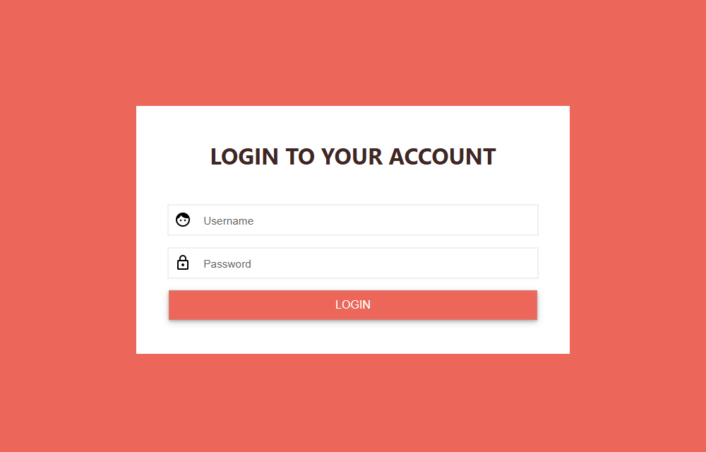

## SVG Progress Ring

A small JavaScript library (`library.js`) that draws a progress ring in SVG: `new ProgressRing(placeholderId, startAngle, percent, color, direction)`, with methods to change the percentage and colour later. The demo draws a ring at 15%.

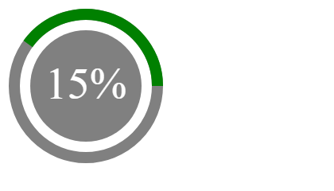

## Fluent Design

Six UI controls styled after Microsoft's Fluent Design (the Windows 10 look): Button, Checkbox, Link Button, ProgressBar (normal, linear indeterminate and circular indeterminate), Radio Button and Toggle Button. Each control has its own demo page, and the project's index page links to all six.

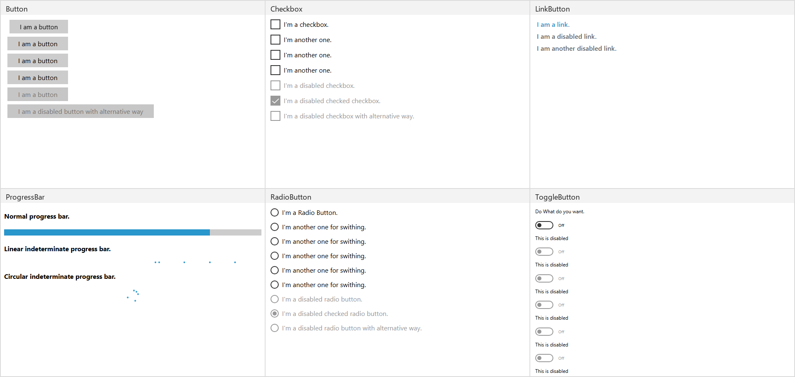

This repository started as `Fluent-Design`. Its three original commits are kept in the history:

- The first is the original 2019 version: one folder per control, each with its own `.htm` page, plus `Temp Files` (reference screenshots, colour values and a checkmark SVG used while designing).
- The second is the version published in 2022: the folders lost their spaces, each page became `index.htm`, and an index page and an IIS `web.config` were added.
- The third changed the index page links from root paths to relative paths, so the site works from a subfolder.

## TimeLine

A timeline drawn by a small JavaScript class (`lib/time-line.js`): projects appear as dots and technologies as labels along a scale of years and months, read from `data.json` a few points per page; **Next page** moves on. The coloured bands are the layout's debug colours. The history keeps the 2019 skeleton (empty files) and the version published in 2021. It loads `data.json` with `fetch`, so open it through a web server, not from the file system.

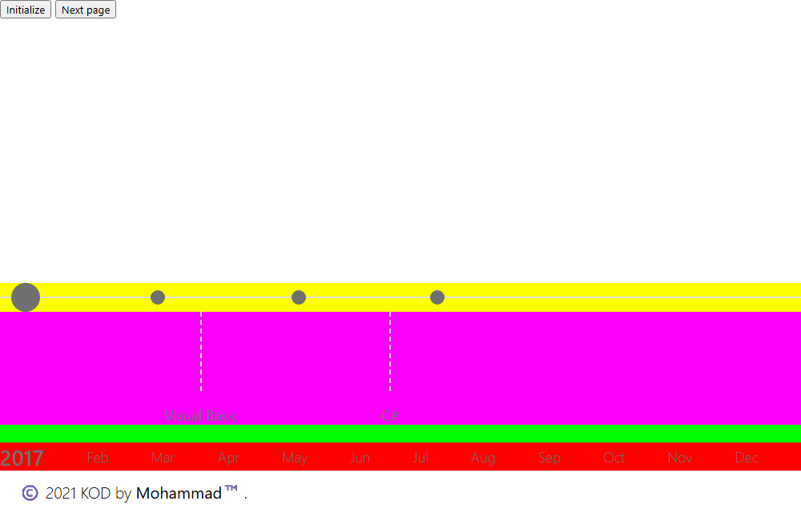

## Sprite Icons

Three icons (next, calendar and apps) drawn as SVG `<symbol>` elements inside the page and reused with `<use>`; three fields change the stroke and fill colours live. `my-icons.svg` holds the same symbols as a standalone file. The second version fixes the reference of the first icon so it shows.

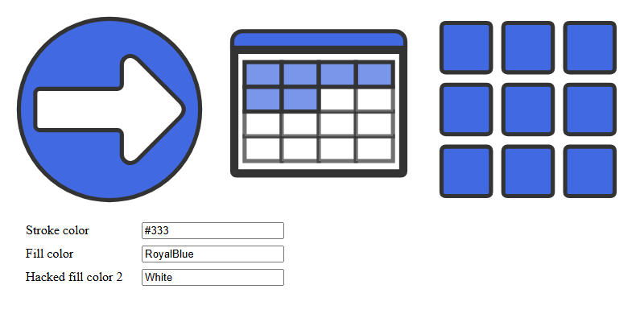

## Run it locally

```
git clone https://github.com/Mohammad-Diab/Mini-Web-Projects.git
```

Then open `index.html`, or any project's `index.htm`, `index.html` or (for Toggle Button) `html.htm`, in a browser. Nothing to install or build.

On GitHub Pages the whole repository is published, and the Pages workflow copies every `index.htm` to `index.html` (and, in a project folder with neither, its page to `index.html`) so each folder opens by its own URL.

## Author

Mohammad Diab

## License

[MIT](LICENSE)
